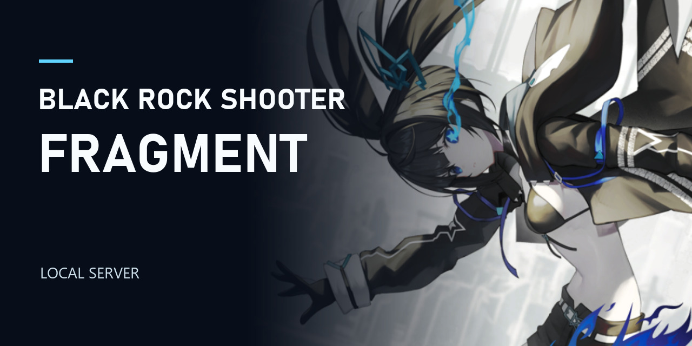

# BLACK★ROCK SHOOTER FRAGMENT local server



**黑岩射手 FRAGMENT / ブラック★ロックシューター FRAGMENT**

[简体中文](README.md) | [日本語](README.ja.md) | [English](README.en.md)

An unofficial server for Black Rock Shooter Fragment. Run it on a PC or through the Android host and manage it in your browser. The game client runs on ARM64 devices with Android 8.0 or later.

**[Download the Android release](https://github.com/fluphus/brsf-server/releases/latest)** · [Installation guide](#install-extract-import-and-launch) · [Windows server](#windows-server)

## Downloads

To play on Android, download **both APKs and all four resource volumes**.

| Purpose | File |
| --- | --- |
| Game client | [BRSFragment-2.5.0-local-arm64.apk](https://github.com/fluphus/brsf-server/releases/download/v0.1.14/BRSFragment-2.5.0-local-arm64.apk) |
| BRS local host | [BRSFragment-LocalHost-0.1.14.apk](https://github.com/fluphus/brsf-server/releases/download/v0.1.14/BRSFragment-LocalHost-0.1.14.apk) |
| Resource volume 1 | [brs-resources.z01](https://github.com/fluphus/brsf-server/releases/download/v0.1.14/brs-resources.z01) |
| Resource volume 2 | [brs-resources.z02](https://github.com/fluphus/brsf-server/releases/download/v0.1.14/brs-resources.z02) |
| Resource volume 3 | [brs-resources.z03](https://github.com/fluphus/brsf-server/releases/download/v0.1.14/brs-resources.z03) |
| Resource volume 4 (open this to extract) | [brs-resources.zip](https://github.com/fluphus/brsf-server/releases/download/v0.1.14/brs-resources.zip) |

## Install, extract, import, and launch

1. Download the six files above. Keep the four resource volumes in the same folder with their original filenames.
2. Install both APKs, following the Android installation prompts.
3. Open **`brs-resources.zip`** with an extractor that supports split ZIP archives. It automatically reads `.z01`, `.z02`, and `.z03` and extracts **`brs-resources.tar`**.
4. Open **BRS Local Host**. With its service stopped, tap **Import resources**, select the extracted `brs-resources.tar`, and wait for the import to finish.
5. Tap **Start**, wait for the service to become ready, then open **BRS FRAGMENT** to play.

Import resources once. For later sessions, start the local host service before opening the game.

Allow about 25 GB of free space during extraction and import. After a successful import, you can delete the downloaded volumes and extracted TAR. The host retains the imported resources.

To update, finish your battle, close the game, stop the host service, and install the new APKs over the existing apps.

## Windows server

Download the [Windows x64 server ZIP](https://github.com/fluphus/brsf-server/releases/download/v0.1.14/BRSFragment-Server-0.1.14-win-x64.zip) and the four resource volumes listed above. The Windows package includes the server, browser management interface, and .NET runtime.

Unzip the server package. Put all four resource volumes in one folder and open `brs-resources.zip` with a split ZIP extractor. Place the extracted `brs-resources.tar` next to `Brs.Local.Host.exe`, then open PowerShell in that folder and run:

```powershell
.\Brs.Local.Host.exe --data-directory .\local-data --import-content .\brs-resources.tar
.\Brs.Local.Host.exe --data-directory .\local-data
```

After the first start, open `http://127.0.0.1:18180/` and sign in with the administrator credential in `local-data/owner.key`. Import resources once. For later sessions, run the second command. Press Ctrl+C to stop the server.

## Development and builds

The repository contains the shared server, WebUI, Android host, client patches, and build tools. The host and WebUI support Chinese, Japanese, and English, with system-language detection.

- [Build the game client from the original 2.5.0 XAPK](client/README.md)
- [Build the Android host](docs/build-android.md)
- [Build and configure the desktop server](server/BUILDING.md)
- [Resource package details](docs/resource-import.md)

Building the desktop server from source requires .NET SDK 10.0.402 or a later patch in the same series. Choose a data directory and import the resource TAR before starting it.

```sh
dotnet build server/Host/Brs.Local.Host.csproj -c Release
dotnet run --project server/Host -c Release --no-build -- --data-directory ./local-data --import-content ./brs-resources.tar
dotnet run --project server/Host -c Release --no-build -- --data-directory ./local-data
```
